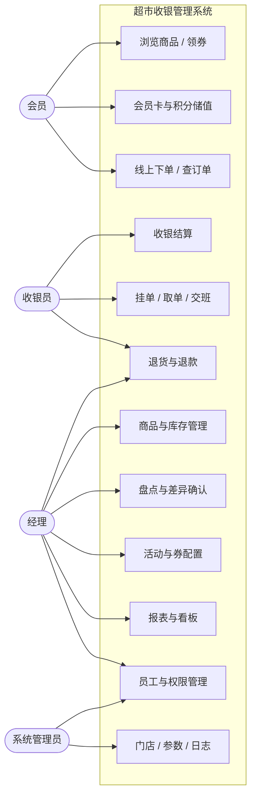
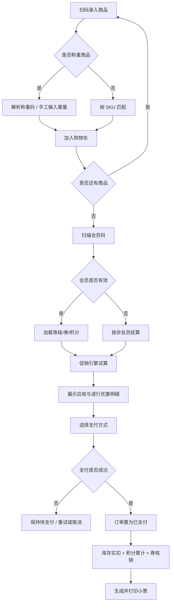
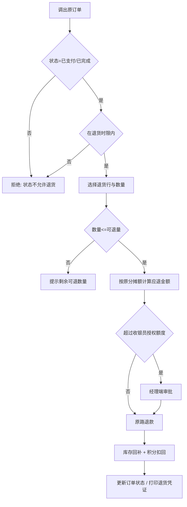
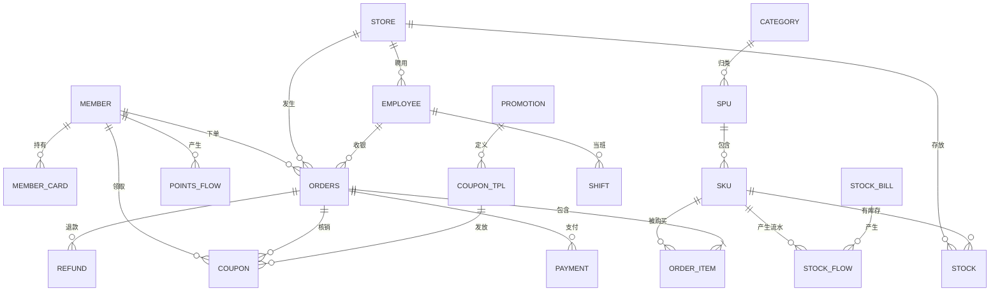

# 软件工程课程设计报告书 · 正文（第 1–3 章）

> 课程设计名称：**超市收银管理系统**
> 专业：____________　年级：____________　组别：____________
> 参与课题人员：____________（6 人）
> 本文件对应答辩报告书评分项：**立项（10 分）、可行性研究（10 分）、需求分析（10 分）**
> 说明：正文按报告书体例撰写，可直接粘贴。图表以 Mermaid 源码给出，渲染后截图插入 Word 即可（也可在 mermaid.live 导出 PNG/SVG）。

---

# 第 1 章　立项

## 1.1 项目背景

零售收银是整个超市业务中"错误代价最高"的环节：价格算错、优惠叠加错、库存对不上、交班账不平，任一环节出错都直接变成金钱损失，且事后难以追溯。

本课题取自课程设计题目第 19 项「超市收银系统」。为避免做成又一份"商品 + 订单 + 用户"的三表增删改查，本组把业务场景收敛到一个更有业务密度的对象上——**会员制仓储式超市**（参照山姆会员商店 Sam's Club）。这类超市与普通超市的差别不在界面，而在业务规则：

| 业务特征 | 带来的系统复杂度 |
|---|---|
| 会员制准入，年费卡 / 储值卡 | 会员身份成为交易的**强制前置条件**，会员中心从"附属模块"升级为核心域 |
| 大包装、批量采购、客单价高 | 单笔订单行数少而金额高，退货、部分退货必须可追溯、可校验 |
| 会员价、满减、券、多件折密集叠加 | 优惠计算顺序与分摊规则必须显式建模，否则退货金额必然算错 |
| 生鲜称重 + 扫码购 | 需要支持称重码、挂单、跨端共享购物车等特殊输入形态 |

## 1.2 项目意义

1. **业务价值**：把"识别会员 → 扫码称重 → 优惠试算 → 收款 → 扣库存 → 出小票 → 交班对账"串成一条真实可跑通的闭环，而不是若干孤立的功能页。
2. **工程价值**：本项目天然包含状态机、并发控制、幂等、权限隔离四类典型工程问题，是练习"设计先于编码"的良好载体。
3. **教学价值**：需求、设计、实现、维护四个阶段都能落到具体交付物上，便于按软件工程规范完整走一遍生命周期。

## 1.3 系统目标

| 目标 | 可验证的判定标准 |
|---|---|
| 业务闭环 | POS 能独立完成一笔含会员价 + 券 + 称重商品的收银，单笔耗时 ≤30 秒 |
| 数据一致 | 100 笔并发下单不超卖；支付重复回调不重复扣款 |
| 角色隔离 | 三类角色越权访问全部被拦截，并提供越权测试用例 |
| 管理可用 | 经理能建商品、配活动、看日报，报表数据与订单明细可逐笔对上 |
| 工程规范 | 分层清晰、接口文档完备、可一键部署复现演示环境 |

## 1.4 系统范围与边界

**范围内（In Scope）**

- 单门店、三终端：会员 H5、收银 POS、管理端 PC；
- 商品与价格管理、库存流转与盘点、会员卡与积分储值；
- 促销活动与优惠券、订单与退货、多渠道收款（模拟）、交班对账；
- 经营报表与看板、员工与权限管理。

**范围外（Out of Scope，作为后续版本演进）**

| 不做的事 | 原因 |
|---|---|
| 多门店库存调拨、供应链采购 | 业务链过长，超出 10 周课程周期 |
| 真实微信/支付宝商户号接入 | 涉及资质与资金，改用模拟网关保证演示完整 |
| 自助收银机固件、电子秤硬件协议对接 | 依赖硬件设备，以"称重码 + 手工录入"替代 |
| 线上配送与仓配调度 | 属电商域，与本课题核心链路无关 |
| 微服务拆分 | 6 人 10 周内，部署与联调成本远超收益；模块边界已通过分包与接口契约体现 |

> 范围边界的显式声明，是立项阶段最重要的产出之一——它把"做不完"的风险提前变成"说清楚"的共识。

## 1.5 角色定义

| 角色 | 使用终端 | 核心诉求 | 权限特征 |
|---|---|---|---|
| 客户端会员 Customer | 手机 H5 | 查商品、看权益、查订单积分、领券 | 只能访问**自己的**数据 |
| 收银员 Cashier | POS 收银台 | 快（≤30 秒/单）、准（零差错）、可挂单可退货 | 绑定当班门店与班次，受授权额度限制 |
| 经理 / 管理员 Manager | PC 管理端 | 管商品、管库存、配活动、看报表、管员工 | 门店级数据范围（dataScope） |
| 系统管理员 SysAdmin | PC 管理端 | 账号、角色、字典、日志、参数 | 不参与业务操作，仅配置与审计 |

## 1.6 技术路线

| 层次 | 选型 | 选择理由 |
|---|---|---|
| 后端 | Java 17 + Spring Boot 3 + MyBatis-Plus | 生态成熟、事务与安全框架完备，适合承载交易类业务 |
| 数据库 | MySQL 8.0 + Redis | 关系型保证交易一致性；Redis 承担会话、库存预占与热点缓存 |
| 会员端 | Vue 3 + Vant（H5） | 移动端组件完备，扫码即用，无需安装 |
| 收银端 | Vue 3 + Element Plus（Web） | 全键盘操作友好，可直接接收扫码枪的键盘模拟输入 |
| 管理端 | Vue 3 + Element Plus + ECharts | 后台范式成熟，图表能力满足看板需求 |
| 接口 | RESTful + JSON + JWT + OpenAPI 3 | 契约先行，三端可并行开发 |
| 架构形态 | 分层架构 + 模块化单体 | 边界清晰且部署简单，符合课程规模 |

## 1.7 项目计划

| 阶段 | 周次 | 主要产出 |
|---|---|---|
| 立项与可行性 | 第 1 周 | 需求冻结、原型、ER 图、本报告第 1–2 章 |
| 需求分析 | 第 1–2 周 | 用例模型、用例规约、数据字典、第 3 章 |
| 总体设计 | 第 2–3 周 | 架构图、模块划分、依赖关系、接口契约 v1 |
| 详细设计 | 第 3–4 周 | 类图、时序图、状态机、关键算法 |
| 编码实现 | 第 2–9 周 | 6 个迭代，每迭代末可演示 |
| 测试与维护 | 第 9–10 周 | 测试报告、压测报告、部署与备份方案 |
| 答辩准备 | 第 10 周 | 演示脚本、录屏、PPT |

关键里程碑：**MS1 地基通（第 3 周末）→ MS2 收银闭环（第 6 周末）→ MS3 营销生效（第 8 周末）→ MS4 功能完备（第 9 周末）→ MS5 交付（第 10 周末）**。

---

# 第 2 章　可行性研究

## 2.1 技术可行性

| 关键技术点 | 成熟度 | 论证 |
|---|---|---|
| 三端 + 后端单体架构 | 高 | 主流前后端分离范式，参考实现充足，组内已具备 Vue / Spring Boot 基础 |
| 订单状态机 | 中 | 无需框架，用状态转移表 + 表驱动测试即可，实现成本可控 |
| 库存并发预占 | 中 | 乐观锁（version）+ 重试为常规方案；Redis 可作辅助，不引入分布式事务 |
| 促销计算引擎 | 中 | 规则需自行建模，但采用"纯函数 + 单测覆盖"可控 |
| 支付渠道 | 高 | 采用适配器模式 + 模拟网关，规避真实商户资质与资金风险 |
| 小票打印 / 扫码枪 | 中 | 浏览器打印 + 键盘模拟输入，**需第 3 周提前验证**，并准备手工输入降级方案 |

**结论：技术上可行。** 唯一需要提前验证的是硬件交互环节，已列为风险项并安排第 3 周专项验证。

## 2.2 经济可行性

- **软件成本**：全部采用开源技术栈（Spring Boot、Vue、MySQL、Redis）与免费工具（IntelliJ IDEA 社区版 / VS Code、Git、Docker Desktop），软件采购成本为 **0**。
- **硬件成本**：使用组员个人电脑与本机 Docker 完成开发与演示，无需额外采购。
- **部署成本**：本地演示零成本；若需外网访问，最低配云主机约 100 元/月，可由组费分摊。
- **人力成本**：课程投入，不计货币成本，但按 163 人天估算工作量以控制进度。

**结论：经济上完全可行，直接现金成本趋近于零。**

## 2.3 操作可行性

| 角色 | 操作成本分析 |
|---|---|
| 收银员 | 界面按真实 POS 三栏布局（左扫码区、中明细、右合计与支付），支持 F1–F4 快捷键，扫码枪即插即用；有收银经验者无需培训 |
| 经理 | 采用标准后台范式（查询区 + 表格 + 弹窗表单），与常见管理系统一致，学习成本低 |
| 会员 | H5 扫码即用，底部四 Tab 结构，无安装步骤 |

**结论：操作上可行。** 系统不改变现有收银作业习惯，属于"替代纸笔与 Excel"的增量改进，推行阻力小。

## 2.4 进度可行性

- 可用人力：6 人 × 10 周 × 约 3 人天/周 ≈ **180 人天**；
- 估算工作量：**163 人天**（按模块难度评估汇总，见设计大纲 6.6 节）；
- 余量：约 17 人天（≈10%），可吸收联调返工与突发问题。

**结论：进度可行，但关键路径（订单 + 支付 + POS）没有余量**，必须严格执行"最小闭环先行"策略：第 4 周先打通现金支付，多渠道后置。

## 2.5 法律与合规可行性

- 支付环节不接入真实商户号，使用模拟网关，**不涉及资金清算与支付牌照问题**；
- 商品、会员数据均为自建演示数据，不使用真实企业与个人信息，**不涉及个人信息保护合规风险**；
- 全部依赖为开源许可（Apache-2.0 / MIT），不涉及商业授权。

**结论：合规上无风险。**

## 2.6 风险分析

| 风险 | 概率 | 影响 | 应对措施 |
|---|---|---|---|
| 收银闭环延期（关键路径） | 中 | 高 | 第 4 周先做现金支付最小闭环；前端与后端第 5 周结对联调 |
| 促销规则越写越乱 | 高 | 中 | 引擎纯函数化 + 单测先行，规则配置化，禁止在 Service 堆 if-else |
| 库存并发超卖 | 中 | 高 | 预占模型 + 乐观锁；第 9 周做 50 并发压测并出报告 |
| 前端被接口阻塞 | 高 | 中 | OpenAPI 先行 + Mock 数据 + 自动生成类型 |
| 打印 / 扫码枪环境不通 | 中 | 中 | 第 3 周验证，准备虚拟打印机与手工输入降级 |
| 成员进度不均 | 中 | 中 | 每周看板核对人天，第 8 周做一次任务再平衡 |
| 答辩演示环境故障 | 低 | 高 | 提前录演示视频 + Docker 一键启动脚本 |

## 2.7 可行性研究结论

项目在**技术、经济、操作、进度、合规**五个维度均可行，予以立项。最大风险集中于交易链路，采用"最小闭环先行、契约先行、单测先行"三条策略控制。**建议批准进入需求分析阶段。**

---

# 第 3 章　需求分析

## 3.1 需求获取方法

| 方法 | 对象 / 来源 | 获得的结论 |
|---|---|---|
| 竞品与现场观察 | 山姆会员商店、永辉、本地连锁超市收银台 | 收银动线为"识别会员 → 扫码 → 称重 → 结算 → 出票"，单笔 20–40 秒；会员码置于收银首步 |
| 角色访谈（模拟） | 扮演收银员、值班经理各 1 次 | 收银员最痛的是"改价审批"与"挂单"；经理最痛的是"库存对不上"与"看不清当天卖得怎样" |
| 文档分析 | 超市小票、交班单、盘点表实物 | 小票字段与交班对账口径直接决定了数据模型 |
| 原型迭代 | 三端低保真原型评审 2 轮 | 确认 POS 三栏布局、管理端列表范式、会员端四 Tab 结构 |

## 3.2 角色与用例模型

系统涉及四类角色，其用例关系如下图（会员、收银员、经理共享"登录""查询订单"等公共用例）：

**用例与模块对应**：U1/U3→M10、U2→M04、U4→M06+M07+M11、U5→M08、U6→M06+M07、U7→M02+M03、U8→M03、U9→M05、U10→M09、U11→M01、U12→M13。

## 3.3 核心用例规约

用例规约是需求分析阶段最有说服力的交付物。以下给出 5 个 P0 核心用例的完整规约，其余用例以清单形式给出（见 3.4）。

### 3.3.1 UC-22 收银结算

| 项目 | 内容 |
|---|---|
| 用例编号 | UC-22（关联 UC-16 会员识别、UC-20 试算、UC-23 称重、UC-29/30 收款、UC-37 打印） |
| 用例名称 | 收银结算 |
| 参与者 | 收银员（主）、会员（被动）、支付网关（模拟） |
| 优先级 | P0 |
| 前置条件 | 收银员已登录且已开班；POS 与服务器网络正常；商品已完成建档与定价 |
| 后置条件 | 生成状态为"已支付"的订单；库存已实扣；积分/券/储值已按规则结算；小票已生成 |
| 触发事件 | 顾客携带商品到达收银台 |

**主事件流**

1. 收银员按 F1 将焦点置于扫码框，扫描商品条码；
2. 系统解析条码：普通商品按 SKU 匹配；称重商品按称重码规则解析出商品与重量；
3. 系统将商品加入购物车，服务端返回行小计与当前合计；
4. 收银员扫描会员码（或输入手机号后四位），系统识别会员并返回等级、可用券、积分余额；
5. 重复 1–3 直至商品录入完毕；
6. 收银员按 F4 发起结算，系统调用促销引擎试算，返回应收金额与**逐行优惠明细**；
7. 收银员向顾客确认金额，选择支付方式（现金 / 扫码 / 储值卡）；
8. 系统创建支付单并调用对应渠道；
9. 支付成功后，系统在同一事务内将订单置为"已支付"，并发布支付成功事件，触发库存实扣、积分累计、券核销、储值扣减、销售事实落库；
10. 系统生成小票（含商品明细、优惠明细、实付、找零、积分变动），POS 预览并打印；
11. 用例结束，POS 焦点自动回到扫码框，准备下一笔。

**异常流**

| 编号 | 异常场景 | 处理方式 |
|---|---|---|
| E1 | 条码无法识别 | 提示"条码无效"，允许手工输入商品编码；记录 `manual_input=true` 供审计 |
| E2 | 商品已下架 | 拒绝加入购物车并提示"商品已下架，请联系值班经理" |
| E3 | 库存不足（可售为 0） | 提示"库存不足，仅剩 N 件"，由收银员决定是否继续（继续则走负库存审批） |
| E4 | 会员卡已过期 | 允许继续收银，但**不享受会员价与会员券**，界面明确提示 |
| E5 | 支付超时 / 失败 | 订单保持"待支付"，可重试或取消；取消时释放库存预占 |
| E6 | 支付成功但回调丢失 | 由定时对账任务（每 5 分钟）主动查单补偿，置为已支付 |
| E7 | 打印失败 | 小票数据已落库，支持按订单号补打，不重复计账 |

**业务规则**

- BR1：应收金额 = Σ行小计 − Σ优惠，且 ≥0；金额一律以"分"为单位的整数计算；
- BR2：优惠计算顺序固定为 标准价 → 会员价 → 活动优惠 → 优惠券 → 积分抵扣，不可调换；
- BR3：积分抵扣不得超过订单金额的 30%；
- BR4：库存扣减采用"预占 → 实扣"两阶段，未支付订单的预占在 30 分钟后自动释放。

### 3.3.2 UC-26 整单退货

| 项目 | 内容 |
|---|---|
| 用例编号 | UC-26 |
| 参与者 | 收银员（主）、经理（授权）、会员 |
| 优先级 | P0 |
| 前置条件 | 原订单状态为"已支付"或"已完成"；退货在允许时限内（默认 7 天，参数可配） |
| 后置条件 | 生成退款单；退款金额原路返回；库存回补；积分扣回；订单状态更新为"已退货" |

**主事件流**

1. 收银员通过订单号 / 会员手机号 / 小票条码调出原订单；
2. 系统校验：订单状态、退货时限、可退数量；
3. 收银员选择退货商品与数量，填写退货原因；
4. 系统按原订单的**分摊额**计算应退金额（不重新计算优惠）；
5. 若退款金额超过收银员授权额度（默认 500 元），系统提示需经理授权，经理在管理端审批；
6. 系统调用支付渠道原路退款，储值支付则回充会员余额；
7. 系统发布退货事件，触发库存回补、积分扣回、销售额冲减；
8. 打印退货凭证，用例结束。

**异常流**

- E1 超出退货时限 → 拒绝，提示"已超过 7 天退货期，请联系值班经理"；
- E2 退货数量 > 可退数量 → 拒绝并提示剩余可退数量；
- E3 退款渠道异常 → 退款单置为"退款中"，进入异常单池，人工处理后可重试。

**业务规则**

- BR1：可退数量 = 已购数量 − 已退数量，且 ≥0（不允许超退）；
- BR2：应退金额 = 原订单该行分摊实付额 ÷ 购买数量 × 退货数量，尾差在最后一次退货时结清；
- BR3：赠品、券核销后不支持单独退货，需整单退。

### 3.3.3 UC-10 盘点

| 项目 | 内容 |
|---|---|
| 用例编号 | UC-10 |
| 参与者 | 经理（主）、仓管/收银员（录入） |
| 优先级 | P1 |
| 前置条件 | 经理已创建盘点单并选择盘点范围（全部 / 指定分类 / 指定 SKU） |
| 后置条件 | 生成盘点差异记录与库存调整单，`on_hand` 更新，库存流水新增 |

**主事件流**

1. 经理创建盘点单，系统按范围生成待盘明细（SKU、账面数量）；
2. 录入人员逐项录入实盘数量（支持 Excel 批量导入）；
3. 系统实时计算差异 = 实盘 − 账面，并标记盈亏；
4. 全部录入完成后，经理提交并确认；
5. 系统生成调整单，更新 `on_hand`，写入库存流水（记录变更前后值）；
6. 系统输出盘点差异报表（按盈亏金额排序），用例结束。

**异常流**：盘点单提交前发现漏录 → 允许暂存继续；确认后需重新发起新一轮盘点。

**业务规则**：盘点期间该范围库存禁止出入库（冻结）；差异超过阈值（如金额 >5000 元）需二次确认。

### 3.3.4 UC-35 交班封账

| 项目 | 内容 |
|---|---|
| 用例编号 | UC-35 |
| 参与者 | 收银员（主）、经理（查看） |
| 优先级 | P0 |
| 前置条件 | 收银员处于已开班状态；所有挂单已处理或已释放 |
| 后置条件 | 班次状态置为"已封账"；生成班次对账报表；现金差异需填写说明 |

**主事件流**

1. 收银员发起交班，系统汇总本班数据：现金收款、电子支付、退款、挂单数、订单笔数；
2. 系统按公式计算应存现金 = 期初备用金 + 本班现金收款 − 本班现金退款 − 已上缴；
3. 收银员录入实际清点现金；
4. 系统计算差异 = 实点 − 应存；差异为 0 则直接封账，非 0 需填写说明；
5. 系统封账并生成交班单，收银员退出登录，用例结束。

**业务规则**：已封账的班次不可再产生交易；未封账不得开班新班次（同一收银员）。

### 3.3.5 UC-18 活动配置

| 项目 | 内容 |
|---|---|
| 用例编号 | UC-18 |
| 参与者 | 经理 |
| 优先级 | P0 |
| 前置条件 | 经理已登录且具备"营销配置"权限；商品/分类已存在 |
| 后置条件 | 活动落库并处于"待生效/生效中"，结算时被促销引擎命中 |

**主事件流**

1. 经理选择活动类型（会员价 / 限时折扣 / 满减 / 第二件半价 / 多件折）；
2. 设置适用范围（全部商品 / 指定分类 / 指定 SKU）；
3. 设置规则参数（折扣率、满减门槛与金额、件数条件）与生效时间窗；
4. 设置优先级与是否与其他活动互斥；
5. 系统校验规则合法性（如满减金额不得大于门槛、时间窗不得重叠冲突）；
6. 保存后活动进入待生效，到达开始时间自动生效。

**业务规则**：同类型活动同一时间同一商品只能命中一个（取最优）；不同类型按优先级串行计算；活动一旦开始不可删除，只能提前终止。

## 3.4 功能需求清单

完整清单共 46 条用例，按模块归集。优先级：**P0** 结课验收必须 / **P1** 应完成 / **P2** 可选加分。

| 模块 | 用例编号 | 功能 | 角色 | 优先级 |
|---|---|---|---|---|
| M01 平台权限 | UC-01 | 登录与令牌刷新 | 全部 | P0 |
| | UC-02 | 角色权限分配与菜单渲染 | 管理员 | P0 |
| | UC-03 | 操作审计日志查询 | 经理/管理员 | P1 |
| M02 商品 | UC-04 | 商品增删改查与上下架 | 经理 | P0 |
| | UC-05 | 商品批量导入 | 经理 | P1 |
| | UC-06 | 改价与价格变更留痕 | 经理 | P0 |
| | UC-07 | 前台商品浏览与搜索 | 会员 | P0 |
| M03 库存 | UC-08 | 补货入库（后台直接录入，不接采购系统） | 经理 | P0 |
| | UC-09 | 报损出库 | 经理 | P1 |
| | UC-10 | 盘点与差异确认 | 经理 | P1 |
| | UC-11 | 库存查询与预警 | 经理/收银员 | P0 |
| | UC-12 | 库存流水追溯 | 经理 | P1 |
| M04 会员 | UC-13 | 会员注册与开卡 | 会员 | P0 |
| | UC-14 | 储值充值 | 会员/收银员 | P1 |
| | UC-15 | 积分查询与抵扣 | 会员 | P0 |
| | UC-16 | 会员码生成与识别 | 会员/收银员 | P0 |
| | UC-17 | 会员等级与权益 | 经理 | P2 |
| M05 促销 | UC-18 | 活动创建 | 经理 | P0 |
| | UC-19 | 券模板与发券/领券 | 经理/会员 | P1 |
| | UC-20 | 结算试算与优惠明细 | 收银员 | P0 |
| | UC-21 | 券核销与回滚 | 收银员 | P1 |
| M06 订单 | UC-22 | 收银结算（POS 建单） | 收银员 | P0 |
| | UC-23 | 称重商品录入 | 收银员 | P0 |
| | UC-24 | 订单查询与详情 | 全部 | P0 |
| | UC-25 | 取消订单 | 会员/收银员 | P0 |
| | UC-26 | 整单退货 | 收银员 | P0 |
| | UC-27 | 按行部分退货 | 收银员 | P1 |
| | UC-28 | 会员端下单 | 会员 | P1 |
| M07 支付 | UC-29 | 现金收款与找零 | 收银员 | P0 |
| | UC-30 | 扫码支付（模拟） | 收银员 | P0 |
| | UC-31 | 储值卡扣款 | 收银员 | P1 |
| | UC-32 | 支付回调与幂等 | 系统 | P0 |
| | UC-33 | 退款（原路返回） | 收银员 | P0 |
| | UC-34 | 日结对账与差异单 | 经理 | P1 |
| M08 收银作业 | UC-35 | 开班 / 交班封账 | 收银员 | P0 |
| | UC-36 | 挂单 / 取单 | 收银员 | P0 |
| | UC-37 | 小票预览与打印 | 收银员 | P0 |
| | UC-38 | 超额退款授权 | 经理 | P1 |
| M09 报表 | UC-39 | 经营看板 | 经理 | P0 |
| | UC-40 | 销售与品类报表 | 经理 | P0 |
| | UC-41 | 会员消费分析 | 经理 | P1 |
| | UC-42 | 报表导出 | 经理 | P1 |
| M10 客户端 | UC-43 | 会员端全流程 | 会员 | P1 |
| M11 POS | UC-44 | POS 全流程界面 | 收银员 | P0 |
| M12 管理端 | UC-45 | 管理端 10 个页组 | 经理 | P0 |
| M13 系统管理 | UC-46 | 门店/设备/字典/参数 | 管理员 | P0 |

**统计**：P0 共 26 项（验收底线），P1 共 16 项（决定成绩高度），P2 共 4 项（加分展示）。

## 3.5 业务流程

### 3.5.1 收银结算主流程

### 3.5.2 退货流程

### 3.5.3 盘点流程

## 3.6 数据需求

### 3.6.1 概念模型（ER 图）

### 3.6.2 数据字典（核心表）

| 表名 | 关键字段 | 说明 |
|---|---|---|
| member | id, phone, card_no, level_id, points, wallet_balance, status, expire_at | 会员主表，status ∈ 未开通/正常/已过期/已冻结 |
| member_card | id, member_id, type, start_at, end_at, status | type ∈ 年费卡/储值卡 |
| employee | id, no, name, store_id, role_id, status | 员工，绑定门店与角色 |
| spu / sku | spu: id, name, category_id, brand；sku: id, spu_id, barcode, spec, unit, price, member_price, cost, is_weight | 两级商品模型；is_weight 标记称重商品 |
| category | id, parent_id, name, sort | 分类树，parent_id=0 为根 |
| stock | sku_id, store_id, on_hand, locked, available, version | **不变式 on_hand = available + locked**；version 为乐观锁 |
| stock_flow | id, sku_id, type, qty, bill_id, before, after, created_at | 库存流水，只增不改 |
| stock_bill | id, type, status, operator, confirmed_by | type ∈ 入库/报损/盘点 |
| promotion | id, type, scope, rule_json, start_at, end_at, priority, status | 活动，规则以 JSON 存以支持多种类型 |
| coupon_tpl / coupon | tpl: id, amount, threshold, valid_days；coupon: id, member_id, tpl_id, status, used_order_id | 券模板与实例 |
| orders | id, order_no, member_id, store_id, cashier_id, total, discount, payable, paid, status, channel | 订单主表，status 见订单状态机 |
| order_item | id, order_id, sku_id, name_snapshot, price_snapshot, qty, discount_share, cost_snapshot | **含快照与分摊额**，是退货计算的基础 |
| payment | id, order_id, channel, amount, channel_trade_no, status | channel_trade_no 建**唯一索引**保证幂等 |
| refund | id, order_id, item_id, qty, amount, reason, approver, status | 退款单 |
| shift | id, cashier_id, store_id, start_at, end_at, cash_total, diff, status | 班次与交班对账 |
| hold_order | id, cashier_id, cart_json, expire_at | 挂单池 |
| audit_log | id, user_id, action, target, before, after, ip, created_at | 审计日志，只增不改 |
| report_daily | date, store_id, sales, refund, orders, gross_profit | 预聚合报表 |

**三个关键数据设计约束：**

1. **订单明细必须存快照**（商品名、单价、成本、优惠分摊额）——否则商品改价后历史订单与退货金额全部失真；
2. **所有流水表只增不改**（库存、积分、钱包、审计）——保证任何数字都能追溯到"谁在何时因为什么改的"；
3. **金额统一以"分"为单位的整数存储**——避免浮点误差在累加中放大。

## 3.7 非功能需求

| 类别 | 指标 | 验证方式 |
|---|---|---|
| 性能 | 收银单笔业务处理（不含支付等待）≤300ms | 接口压测 |
| 并发 | 30 台收银并发下单不超卖；50 并发下单仅 1 单成功（库存 1 件时） | JMeter 压测 |
| 可用性 | 服务异常后 5 分钟内可重启恢复，数据不丢 | 故障演练 |
| 安全 | 密码 BCrypt；JWT 2 小时过期；接口级权限校验；敏感字段脱敏；操作留审计 | 越权测试用例 |
| 一致性 | 支付与订单状态最终一致；提供每日对账脚本兜底 | 重复回调测试 |
| 易用性 | POS 全键盘可操作，关键操作二次确认；小票可补打 | 可用性走查 |
| 兼容性 | Chrome / Edge 最新版；POS 支持 1366×768 与 1920×1080 | 多分辨率测试 |
| 可维护性 | 分层清晰、配置外置、数据库变更脚本化（Flyway） | 代码评审 |

## 3.8 需求优先级与裁剪策略

采用 MoSCoW 方法对 46 条用例分级，并明确"进度不足时先砍什么"：

| 级别 | 含义 | 条目数 | 裁剪策略 |
|---|---|---|---|
| Must have（P0） | 缺此则系统无法演示闭环 | 26 | 不可裁剪，只能延期 |
| Should have（P1） | 影响完整度与评分高度 | 16 | 按"退货→盘点→报表→客户端"顺序裁剪 |
| Could have（P2） | 加分项 | 4 | 全部可裁剪 |
| Won't have（本期不做） | 多门店、配送、真实支付 | — | 明确写入范围外 |

**若第 8 周进度落后，裁剪顺序为**：会员等级权益 → 报表导出 → 会员端下单 → 会员消费分析 → 部分退货 → 盘点。**核心收银闭环（UC-22/29/30/35/37）任何情况下不动。**

## 3.9 需求追踪矩阵（节选）

| 用例 | 所属模块 | 计划迭代 | 验证方式 |
|---|---|---|---|
| UC-01 登录 | M01 | I1 | 接口测试 |
| UC-04 商品维护 | M02 | I1 | 接口 + UI |
| UC-08 补货入库 | M03 | I2 | 接口测试 |
| UC-11 库存查询 | M03 | I2 | 接口测试 |
| UC-16 会员识别 | M04 | I2 | 接口 + 联调 |
| UC-18 活动配置 | M05 | I3 | UI + 引擎单测 |
| UC-20 试算 | M05 | I3 | 引擎单测（20 例） |
| UC-22 收银结算 | M06/M07/M11 | I2 | 端到端 |
| UC-26 整单退货 | M06/M07 | I3 | 端到端 |
| UC-29/30 收款 | M07 | I2 | 接口 + 模拟回调 |
| UC-32 回调幂等 | M07 | I2 | 并发重复回调测试 |
| UC-35 交班 | M08 | I3 | 端到端 |
| UC-39 看板 | M09 | I4 | 数据核对 |
| UC-45 管理端 | M12 | I2–I4 | UI 走查 |

> 完整矩阵在测试阶段补齐，作为"需求—设计—实现—测试"可追溯性的证据，是课程报告中体现工程规范的重要材料。

---

## 本章小结

第 1–3 章完成了从"为什么做"到"做什么"的过渡：

- **立项**明确了业务定位（会员制仓储超市）、范围边界（5 项明确不做）与可验证的目标；
- **可行性**从技术、经济、操作、进度、合规五方面论证通过，并识别出交易链路为唯一高风险区；
- **需求分析**用 46 条用例覆盖三类角色，对 5 个核心用例给出完整规约，并建立了 ER 模型、数据字典与非功能指标。

下一章（第 4 章 形式化说明技术运用）将把本章中"不能出错"的三处规则——订单状态迁移、库存守恒、优惠分摊——用状态转移表与不变式钉死，并说明如何直接转化为单元测试。
